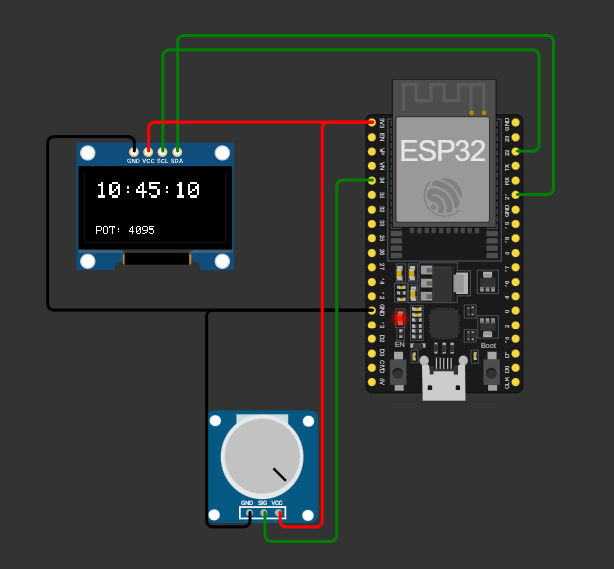

# Punto 2 — I2C: reloj digital y lectura de potenciómetro en OLED SSD1306

## Descripción

Este proyecto utiliza un **ESP32** para mostrar en una pantalla **OLED SSD1306** dos datos en tiempo real:

- Un reloj digital implementado por software.
- El valor leído desde un potenciómetro mediante el convertidor analógico-digital (ADC) del ESP32.

La pantalla se comunica con el microcontrolador mediante el protocolo **I2C**. Los mismos datos también se envían al **Monitor Serial** para facilitar la comprobación del funcionamiento.

> El reloj se genera a partir de `millis()`. Por lo tanto, no conserva la hora real al reiniciar o desconectar el ESP32 y no sustituye un módulo RTC.

---

## Objetivos

- Utilizar el protocolo de comunicación **I2C** con el ESP32.
- Leer una señal analógica mediante el **ADC**.
- Mostrar información en una pantalla OLED SSD1306.
- Implementar una referencia de tiempo mediante `millis()` sin detener la ejecución principal del programa.
- Verificar los datos mediante el Monitor Serial.

---

## Componentes

| Componente | Cantidad | Descripción |
|---|---:|---|
| ESP32 DevKit | 1 | Microcontrolador principal |
| Pantalla OLED SSD1306 | 1 | Pantalla I2C, 128 × 64 píxeles |
| Potenciómetro | 1 | Entrada analógica |
| Cable USB | 1 | Alimentación y programación |
| Computador con Arduino IDE | 1 | Compilación, carga y monitoreo |
| Cables de conexión | Varios | Conexión entre los componentes |

---

## Conexiones

### Pantalla OLED SSD1306

| Pin OLED | ESP32 | Función |
|---|---|---|
| VCC | 3.3 V | Alimentación |
| GND | GND | Tierra |
| SDA | GPIO 21 | Datos I2C |
| SCL | GPIO 22 | Reloj I2C |

### Potenciómetro

| Terminal del potenciómetro | ESP32 | Función |
|---|---|---|
| Terminal lateral 1 | 3.3 V | Referencia positiva |
| Terminal lateral 2 | GND | Referencia negativa |
| Terminal central | GPIO 34 | Entrada analógica ADC1 |

El orden de los dos terminales laterales puede invertirse. Esto únicamente cambia el sentido en el que aumenta o disminuye la lectura al girar el potenciómetro.

### Esquema



---

## Preparación del entorno

### 1. Instalar Arduino IDE

Instale **Arduino IDE** y configure el soporte para placas ESP32 si todavía no se encuentra disponible en el entorno.

### 2. Seleccionar la placa

Conecte el ESP32 al computador mediante USB y seleccione en Arduino IDE:

**Herramientas → Placa → ESP32 Arduino → ESP32 Dev Module**

Seleccione también el puerto correspondiente al dispositivo desde:

**Herramientas → Puerto**

### 3. Instalar las librerías

Desde el **Gestor de bibliotecas** de Arduino IDE instale:

- `Adafruit GFX Library`
- `Adafruit SSD1306`

La librería `Wire`, utilizada para I2C, forma parte del entorno Arduino y no requiere una instalación adicional.

---

## Código

```cpp
#include <Wire.h>
#include <Adafruit_GFX.h>
#include <Adafruit_SSD1306.h>

#define ANCHO 128
#define ALTO 64
#define OLED_RESET -1

Adafruit_SSD1306 display(ANCHO, ALTO, &Wire, OLED_RESET);

const int potPin = 34;

int hora = 3;
int minuto = 26;
int segundo = 0;

unsigned long previo = 0;
const unsigned long intervalo = 1000;

void setup() {
  Serial.begin(115200);

  if (!display.begin(SSD1306_SWITCHCAPVCC, 0x3C)) {
    Serial.println("No se detecta pantalla SSD1306");
    for (;;);
  }

  display.clearDisplay();
  display.display();

  Serial.println("Iniciando reloj digital con lectura de potenciometro...");
}

void loop() {
  int valor = analogRead(potPin);
  unsigned long actual = millis();

  if (actual - previo >= intervalo) {
    previo = actual;
    segundo++;

    if (segundo >= 60) {
      segundo = 0;
      minuto++;

      if (minuto >= 60) {
        minuto = 0;
        hora++;

        if (hora >= 24) {
          hora = 0;
        }
      }
    }

    Serial.print("Hora actual: ");
    if (hora < 10) Serial.print("0");
    Serial.print(hora);
    Serial.print(":");
    if (minuto < 10) Serial.print("0");
    Serial.print(minuto);
    Serial.print(":");
    if (segundo < 10) Serial.print("0");
    Serial.print(segundo);
    Serial.print(" | Potenciometro: ");
    Serial.println(valor);
  }

  display.clearDisplay();
  display.setTextColor(SSD1306_WHITE);

  display.setTextSize(2);
  display.setCursor(10, 10);

  if (hora < 10) display.print("0");
  display.print(hora);
  display.print(":");
  if (minuto < 10) display.print("0");
  display.print(minuto);
  display.print(":");
  if (segundo < 10) display.print("0");
  display.print(segundo);

  display.setTextSize(1);
  display.setCursor(10, 50);
  display.print("POT: ");
  display.print(valor);

  display.display();

  delay(100);
}
```

---

## Carga y ejecución

1. Realice las conexiones indicadas en las tablas anteriores.
2. Conecte el ESP32 al computador mediante USB.
3. Abra el código en Arduino IDE.
4. Compruebe que estén seleccionados la placa y el puerto correctos.
5. Compile el programa con **Verificar**.
6. Cargue el programa al ESP32 con **Subir**.
7. Abra el **Monitor Serial**.
8. Configure la velocidad del Monitor Serial en **115200 baudios**.
9. Gire el potenciómetro y compruebe que el valor mostrado cambie tanto en la OLED como en el Monitor Serial.

---

## Funcionamiento del programa

### Inicialización

Al iniciar, el ESP32 configura la comunicación serial a **115200 baudios** e intenta inicializar la pantalla OLED en la dirección I2C `0x3C`.

Si la pantalla no responde, el programa muestra el mensaje:

```text
No se detecta pantalla SSD1306
```

y detiene la ejecución.

### Lectura del potenciómetro

El terminal central del potenciómetro está conectado al **GPIO 34**, perteneciente al ADC1 del ESP32. El programa obtiene su valor mediante:

```cpp
int valor = analogRead(potPin);
```

Con la configuración utilizada, la lectura esperada se encuentra aproximadamente entre **0 y 4095**.

### Reloj por software

La función `millis()` permite determinar cuándo ha transcurrido aproximadamente un segundo sin utilizar un `delay(1000)` para controlar el reloj.

Cada segundo se incrementa la variable `segundo`. Al alcanzar 60 segundos se incrementan los minutos; al alcanzar 60 minutos se incrementan las horas; y al alcanzar 24 horas el conteo vuelve a cero.

La hora inicial se define en estas variables:

```cpp
int hora = 3;
int minuto = 26;
int segundo = 0;
```

Puede modificarlas antes de cargar el programa si se desea iniciar el contador desde otra hora.

### Visualización en la OLED

La pantalla muestra:

- En la parte superior: la hora en formato `HH:MM:SS`.
- En la parte inferior: el valor instantáneo del potenciómetro.

Ejemplo:

```text
03:26:15
POT: 1308
```

### Monitor Serial

Cada segundo se envía una línea con la hora y el valor del ADC:

```text
Hora actual: 03:26:01 | Potenciometro: 1324
Hora actual: 03:26:02 | Potenciometro: 1308
```

---

## Verificación del funcionamiento

El montaje funciona correctamente si se cumplen las siguientes condiciones:

1. La pantalla OLED enciende y muestra la hora.
2. El reloj incrementa los segundos de manera continua.
3. El valor `POT` cambia al girar el potenciómetro.
4. El Monitor Serial muestra los mismos datos a **115200 baudios**.
5. La lectura del potenciómetro se mantiene aproximadamente dentro del intervalo de 0 a 4095.

---

## Solución de problemas

### La pantalla OLED no muestra información

- Verifique las conexiones de `VCC`, `GND`, `SDA` y `SCL`.
- Compruebe que `SDA` esté conectado al GPIO 21 y `SCL` al GPIO 22.
- Verifique que las librerías de Adafruit estén instaladas.
- La dirección utilizada por el programa es `0x3C`. Algunos módulos SSD1306 pueden utilizar `0x3D`; en ese caso debe modificarse la dirección en `display.begin()`.

### El valor del potenciómetro no cambia

- Compruebe que el terminal central esté conectado al GPIO 34.
- Verifique que los terminales laterales estén conectados a 3.3 V y GND.
- Compruebe que exista una tierra común entre todos los componentes.

### No aparece información en el Monitor Serial

- Configure el Monitor Serial a **115200 baudios**.
- Verifique que esté seleccionado el puerto correcto.
- Reinicie el ESP32 después de abrir el Monitor Serial si es necesario.

---

## Consideraciones

- El **GPIO 34** del ESP32 se utiliza únicamente como entrada, por lo que es apropiado para la lectura del potenciómetro.
- No aplique al GPIO 34 una tensión superior a **3.3 V**.
- El reloj implementado no mantiene la hora después de un reinicio.
- Si se requiere conservar la hora real, se debe utilizar un RTC externo o sincronización mediante red.

---

## Autor

**Jerónimo Novoa Giraldo**  
Curso de Instrumentación Electrónica.
